# 🌟 Awesome Customer Service Management (CSM)

  

  
  
  
  
  

> 🚀 A curated list of leading **Customer Service Management (CSM)** platforms, helpdesk ticketing systems, omnichannel customer support software, and open-source customer service engines.

Focused on customer ticketing 🎫, help desk operations 🎧, shared team inboxes 📥, omnichannel customer engagement 🌐 (email, live chat, WhatsApp, SMS, voice), SLA monitoring ⏱️, and AI customer support automation 🤖.

---

## 📑 Table of Contents

- [📊 Sector Overview & Market Dynamics](#-sector-overview--market-dynamics)
- [☁️ SaaS / Hosted Platforms](#️-saas--hosted-platforms)
- [💻 Open-Source GitHub Projects](#-open-source-github-projects)
- [🏗️ Architectural Patterns: Building Custom Self-Hosted CSM](#️-architectural-patterns-building-custom-self-hosted-csm)
- [🤝 How to Contribute](#-how-to-contribute)
- [💖 Support](#-support)
- [⭐ Star History](#-star-history)
- [⚠️ Disclaimer](#️-disclaimer)

---

## 📊 Sector Overview & Market Dynamics

The global Customer Service Management & Customer Experience (CX) software sector represents an estimated market size of **$15B–$26B** (scaling as part of the broader $86B+ global CRM ecosystem) 📈. The sector is **moderately fragmented across mid-market point solutions and niche disruptors, yet heavily concentrated at the enterprise core** 🏢, where a handful of dominant platform giants (Salesforce, ServiceNow, Zendesk, HubSpot) command the lion's share of overall enterprise spend and drive continuous consolidation through AI-driven acquisitions 🧠.

---

## ☁️ SaaS / Hosted Platforms

Leading commercial Customer Service Management and ticketing software platforms, sorted by company scale (market capitalization / valuation / annual revenue, descending) 🏆.

| Product | 🏢 Company Size (Market Cap / Valuation / Revenue) | 💵 Starting Price | 🎁 Free Tier / Trial Limits | 📝 Description |
| :--- | :--- | :--- | :--- | :--- |
| **[Salesforce Service Cloud](https://www.salesforce.com/products/service-cloud/)** | ~$280B Market Cap (FY25 Revenue: $34.9B) | $25 / user / month (Starter Suite, billed annually) | 30-day free trial; full Starter Suite features included, no credit card required | Enterprise customer service & case management platform with AI agent assistance (Agentforce/Einstein), omnichannel routing, and knowledge bases. |
| **[ServiceNow CSM](https://www.servicenow.com/products/customer-service-management.html)** | ~$190B Market Cap (FY24 Revenue: $10.0B) | ~$130 / user / month (Standard Fulfiller estimate; custom contract) | 14-day free developer instance (PDI) with full developer suite and sandbox case management; enterprise trial via sales quote | Enterprise CSM software bridging customer service with IT/Field Service workflows, proactive case resolution, and AI workflows. |
| **[HubSpot Service Hub](https://www.hubspot.com/products/service)** | ~$32B Market Cap (FY24 Revenue: $2.6B) | $15 / seat / month (Service Hub Starter, billed annually) | Free forever plan with up to 5 users, shared inbox, ticketing, closed-loop reporting, and live chat widget | Inbound customer service software natively unified with HubSpot CRM, shared inbox, customer feedback surveys, and knowledge base. |
| **[Zendesk Support](https://www.zendesk.com/service/)** | $10.2B Acquisition Valuation (Hellman & Friedman / Permira) | $19 / agent / month (Support Team, billed annually) | 14-day free trial with full Zendesk Suite Professional features and omnichannel channels | Industry benchmark ticketing platform featuring automated ticket routing, SLA monitoring, omnichannel support, and thousands of marketplace apps. |
| **[Zoho Desk](https://www.zoho.com/desk/)** | $1B+ Annual Revenue (Bootstrapped, Zoho Corporation) | $14 / agent / month (Standard plan, billed annually) | Free forever plan for up to 3 agents with email ticketing, customer management, and private knowledge base; 15-day free trial for paid tiers | Context-aware helpdesk software with multi-department ticketing, SLA management, and Zia AI assistant. |
| **[Front](https://front.com/)** | $1.7B Valuation (Series D) | $19 / seat / month (Starter plan, billed annually) | 7-day free trial on Starter and Growth plans with full team collaboration and email routing features | Customer operations and shared inbox platform built for collaborative support teams, message assignment rules, and analytics. |
| **[Kustomer](https://www.kustomer.com/)** | ~$1B Acquisition / Spun Out (Backed by Redpoint & Battery) | $89 / user / month (Enterprise tier, 8-seat minimum, billed annually) | 14-day free trial upon request; standard access to omnichannel timeline and case management | Conversational customer service CRM with unified single-timeline customer history and AI-driven workflow automation. |
| **[Freshdesk](https://freshdesk.com/)** | Part of Freshworks (~$3.8B Market Cap, FY24 Revenue: $700M+) | $15 / agent / month (Growth plan, billed annually) | Free forever plan for up to 10 agents with email/social ticketing, ticket dispatch, and knowledge base; 14-day free trial on paid plans | Cloud-based customer support software featuring omnichannel ticketing, ticket automation, collaborative resolution, and Freddy AI. |
| **[HappyFox](https://www.happyfox.com/)** | ~$20M+ Annual Revenue (Bootstrapped / Private) | $29 / agent / month (Mighty plan, billed annually) | 14-day free trial with full access to multi-channel ticketing, SLA management, and knowledge base | Help desk software providing ticketing, SLA escalation workflows, asset tracking, and customer self-service portals. |
| **[Kayako](https://kayako.com/)** | ESW Capital Portfolio Company (~$10M–$20M Revenue) | $79 / agent / month (Kayako One, billed annually) | 14-day free trial with access to unified inbox, live chat, and automated ticketing | Helpdesk platform featuring unified customer conversations, live chat, self-service portals, and AI deflection agents. |

---

## 💻 Open-Source GitHub Projects

Curated self-hosted and open-source customer service management software, helpdesks, and shared inboxes, sorted by GitHub_Stars (descending) 🌟.

| Project | 📜 License | 🛠️ Tech Stack | 💡 Highlights |
| :--- | :--- | :--- | :--- |
| **[Chatwoot](https://github.com/chatwoot/chatwoot)**  | AGPL-3.0 / Fair Source | Ruby on Rails, Vue.js | Leading open-source omnichannel customer engagement platform and alternative to Intercom/Zendesk. Unifies live chat, email, WhatsApp, Telegram, Facebook, Instagram, and SMS into one multi-agent shared inbox with AI agent triage. |
| **[UVdesk](https://github.com/uvdesk/community-skeleton)**  | OSL-3.0 | PHP, Symfony | Enterprise-ready open-source helpdesk ticketing system designed for multi-channel support, customer self-service portal, customizable workflows, and e-commerce platform integrations. |
| **[GLPI](https://github.com/glpi-project/glpi)**  | GPL-3.0 | PHP | Comprehensive open-source IT service management (ITSM) and helpdesk system featuring ITIL-aligned service desk workflows, asset management, data center infrastructure, and issue tracking. |
| **[Papercups](https://github.com/papercups-io/papercups)**  | MIT | Elixir, Phoenix, React | Lightweight, privacy-focused open-source live customer messaging platform. Embeddable widget with bidirectional Slack, email, and SMS synchronization. |
| **[Zammad](https://github.com/zammad/zammad)**  | AGPL-3.0 | Ruby on Rails, React | Polished, modern web-based helpdesk and ticketing system. Delivers omnichannel support (email, phone, SMS, Telegram, WhatsApp), SLA tracking, custom ticket fields, audit logging, and ITIL workflows. |
| **[FreeScout](https://github.com/freescout-help-desk/freescout)**  | AGPL-3.0 | PHP, Laravel | Ultra-lightweight self-hosted Help Scout & Zendesk alternative. Runs smoothly on low-resource VPS (1-2 GB RAM), supporting unlimited mailboxes, users, multi-language support, and modular extensions. |
| **[erxes](https://github.com/erxes/erxes)**  | AGPL-3.0 | Node.js, GraphQL, React | Open-source Experience Operating System (XOS) combining customer support inboxes, marketing automation, service pipelines, task boards, and CRM. |
| **[osTicket](https://github.com/osTicket/osTicket)**  | GPL-2.0 | PHP | Proven and battle-tested open-source customer support ticketing solution. Features seamless email piping, auto-responder workflows, customizable customer self-service portal, and SLA management. |
| **[Chaskiq](https://github.com/chaskiq/chaskiq)**  | Apache-2.0 | Ruby on Rails, React | Conversational marketing and support platform built as an open-source alternative to Intercom and Drift. Features live messenger, conversational bot automations, and CRM integrations. |
| **[Frappe Helpdesk](https://github.com/frappe/helpdesk)**  | AGPL-3.0 | Python, Frappe, Vue.js | Streamlined, modern customer service software built on Frappe Framework. Offers clean customer and agent portals, ticket assignment automation, SLA resolution clocks, and full integration with ERPNext. |
| **[Peppermint](https://github.com/Peppermint-Lab/peppermint)**  | MIT | Node.js, Express, React | Modern, lightweight, open-source ticket and issue management system designed as an intuitive alternative to Zendesk and Jira Service Desk for fast-growing support teams. |
| **[Helpy](https://github.com/helpyio/helpy)**  | MIT | Ruby on Rails | Modern mobile-friendly customer support desk featuring multi-channel email ticketing, searchable knowledge base, and interactive customer community forums. |
| **[Live Helper Chat](https://github.com/LiveHelperChat/livehelperchat)**  | Apache-2.0 | PHP | Flexible live support system with web and mobile applications, voice/video/screenshare capabilities, Telegram/WhatsApp/Facebook bot integration, and multi-department routing. |
| **[Trudesk](https://github.com/polonel/trudesk)**  | GPL-3.0 | Node.js, MongoDB, Angular | Open-source help desk and ticketing solution featuring real-time socket communication, agent notifications, public/private knowledge base, and customer portal. |
| **[Faveo Helpdesk](https://github.com/ladybirdweb/faveo-helpdesk)**  | OSL-3.0 | PHP, Laravel | Ticket management system offering multi-channel ticketing, SLA policy management, customer knowledge base, and built-in audit trails. |
| **[iTop](https://github.com/Combodo/iTop)**  | AGPL-3.0 | PHP | Open-source IT Service Management (ITSM) and CMDB platform with customizable service desk ticketing, incident tracking, user portal, and IT change management. |
| **[OpenSupports](https://github.com/opensupports/opensupports)**  | GPL-3.0 | PHP, React | Clean, intuitive ticket management solution featuring responsive customer portal, agent ticket management, customizable departments, and knowledge base articles. |
| **[Znuny](https://github.com/znuny/Znuny)**  | GPL-3.0 | Perl | Fork of OTRS Community Edition. Proven open-source ticketing platform built for complex enterprise customer service, ITSM, and high-volume ticket routing. |

---

## 🏗️ Architectural Patterns: Building Custom Self-Hosted CSM

For engineering teams constructing internal or self-hosted support architectures 🛠️:
- **Omnichannel Live & Conversational Inboxes:** Deploy **[Chatwoot](https://github.com/chatwoot/chatwoot)** or **[Papercups](https://github.com/papercups-io/papercups)** to unify live web chat, WhatsApp, and social inboxes.
- **Structured Helpdesk & SLA Workflows:** Deploy **[Zammad](https://github.com/zammad/zammad)** or **[Frappe Helpdesk](https://github.com/frappe/helpdesk)** for strict SLA tracking, assignment matrices, and ITIL workflows.
- **Low-Footprint Email Shared Mailboxes:** Deploy **[FreeScout](https://github.com/freescout-help-desk/freescout)** on standard VPS infrastructure for clean email collaboration.
- **IT Service & Asset Management:** Deploy **[GLPI](https://github.com/glpi-project/glpi)** or **[iTop](https://github.com/Combodo/iTop)** for hardware asset tracking and internal employee service requests.

---

## 🤝 How to Contribute

Contributions are always welcome! 💖

1. Fork this repository 🍴.
2. Add or update entries in `README.md`. Ensure SaaS entries include verified starting prices, free tier limits, and valuation/revenue indicators. For open-source tools, include the official GitHub repo and Stars_Badge.
3. Submit a pull request with a concise summary of changes 🚀.

---

## 💖 Support

Thank you for exploring this curated Customer Service Management ecosystem list! 🙏 If you found this repository helpful, please consider:
- ⭐ **Starring** this repository on GitHub
- 🍴 **Forking** and contributing your favorite CSM tools
- 📢 **Sharing** this guide with teammates, support managers, and developers
- ☕ **Buying a coffee / sponsoring** further open-source research via the [GitHub Sponsors Dashboard](https://github.com/sponsors/ishandutta2007)

Your support keeps this curation active, up-to-date, and free for the community! 🚀

---

## 🌟 Star History

---

## ⚠️ Disclaimer

- This repository is a community-maintained resource and does not constitute commercial endorsement.
- All pricing, tier limits, and corporate valuation figures reflect public industry data and vendor disclosures as of 2025–2026; vendors may modify plan structures over time.
- Systems processing customer data should strictly comply with regulatory standards (GDPR, CCPA, HIPAA, SOC 2).
